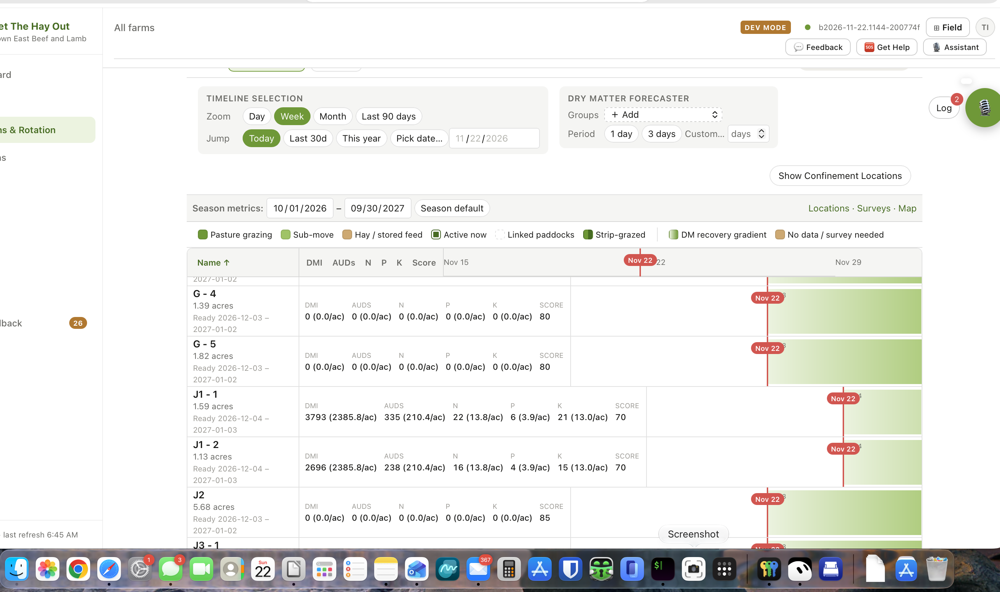

# Per-location metrics block layout (OI-0252)

**Status:** **SPEC LOCKED / READY FOR BUILD** (Tim, 2026-11-22 ~7:36–7:37 AM ET, via Orchestrator; card **t1000s3983** “I want to change something”; typed **t1002u**) — **Ls+Wu+Sb+Br+Nn+Pp+Uf+D0**. Docs tip ready for Tim’s land of **docs**. This tip is **docs only**. **No SQL / no migration / no src edits on this tip.**  
**Owner:** GTHO Design → GTHO Build (after docs live on main; implement **after PR #126 / OI-0249** is on main so partial markers are in the width measure).  
**Parent:** Forgejo `origin/main` `d6a18e8e76d69fbb717dc4ff599b00e8c4316a83` (OI-0250 docs live via PR #127; compiled `RELEASED_SCHEMA_VERSION` **48**).  
**Also related:** OI-0246 Locations management + season formula / list-parity ([LOCATIONS_MANAGEMENT_VIEW_2026-11-21.md](LOCATIONS_MANAGEMENT_VIEW_2026-11-21.md)); OI-0249 partial unknown **Zp+…** (PR #126 restacking onto `d6a18e8` — sequence layout **after #126**); OI-0250 period-totals strip (**LOCKED**, docs live on main `d6a18e8` — **not** redesigned here); OI-0251 Sheep backfill + Ap include-archived preference (parallel docs tip — when Ap is on, archived locs that appear in the metrics set join the width pool).  
**Schema / migration:** **D0 — none.** Layout + CSS/measure only. Reuse `formatMetricValue` / farm unit helpers; after #126, include OI-0249 partial marker text in the width measure.

## 1. Problem

Tim ask **t996u** (2026-11-22 ~7:32 AM ET, via Orchestrator), verbatim intent:

> the data on each pasture needs to be a standard length so that they all line up regardless of amounts. lets put the DMI and AUD info stacked on to of the NPK and pasture score and then standardize the width that renders based on teh loacation with the highest values and teh width that it needs

Today each Calendar management row renders **six metrics in one flat horizontal cell**. Digits and optional per-acre parentheticals vary by location, so the blocks do not line up down the list. Tim wants (1) **two stacked lines** — DMI + AUDs on top, NPK + Score below — and (2) **one uniform content width** sized from the **widest-rendering** visible location so columns align.

### Evidence — **t998u** (same minute, via Orchestrator)

Tim typed: “example fo current issue here” and shared a screenshot of **Locations & Rotation**, **Week** view, stamp **b2026-11-22.1144-200774f**.

Concrete rows from that shot (season metrics left of the timeline):

| Location | Metrics (as rendered) | Effect on timeline |
|---|---|---|
| **G-4**, **G-5**, **J2** | Zeros (narrow metrics block) | Nov 22 “today” line / timeline starts further **left** |
| **J1-1** | DMI **3793** (2385.8/ac), AUDs **335** (210.4/ac), N **22** (13.8/ac), plus P/K/Score | Wider block → timeline pushed **right** |
| **J1-2** | Similar non-zero (DMI **2696** etc.) | Same right-shift pattern |

The vertical today/timeline column is **jagged** because `.loc-mgmt__metrics` is **content-sized per row**. That is exactly the defect **Wu** fixes: one shared metrics-block width so G-4 and J1-1 (and every other visible row) align and Nov 22 is a straight vertical.

## 2. Current state (citations — do not invent)

Read on writer / main lineage at `d6a18e8` (calendar code also present on writer tip `a07f591`).

| Piece | Where | What it does today |
|---|---|---|
| Flat metric cols | `src/features/events/rotation-calendar/calendar-grid.js` `METRIC_COLS` | One horizontal set: **DMI**, **AUDs**, **N**, **P**, **K**, **Score** (labels/titles unchanged). |
| Per-row cell | same file — `.loc-mgmt__metrics` | Each metric is label + `formatMetricValue` (+ optional per-acre parenthetical for some keys). Same cols on phone and desktop. |
| Phone breakpoint | `isPhone` = `window.innerWidth < 900` | Layout class `loc-mgmt--phone` vs `--desktop`; metrics columns are **not** restacked today. |
| Values | `location-metrics.js` / `formatMetricValue` | Season window totals; farm unit system. |
| Partial markers | OI-0249 lock; PR #126 (restack onto `d6a18e8` pending) | Muted “ partial” (or equivalent) on affected metric(s) when some weight slices unknown. **Not on main yet** — this OI’s width measure must include the marker once #126 lands. |
| OI-0250 strip | docs live on main `d6a18e8` | Farm-period totals band under season metrics bar / above color key. **Separate** from the per-location metrics block. Does **not** participate in per-location uniform width. |
| OI-0251 Ap | parallel tip (not on this parent) | When include-archived-in-metrics is on, archived locs that show in the metrics set join the same width pool. Ud report-prefs dialog is unrelated to this layout. |
| List parity | OI-0246 **La+…** | List can show the same season-metrics block; this OI’s **Sb** applies the stack + width algorithm there too when List shows that block. |

## 3. Goals / non-goals

**Goals**

- Two-line stack inside the per-location metrics block so DMI/AUDs sit above N/P/K/Score.
- One uniform content width across all **visible** management rows on a surface, sized from the widest rendered block (after format + partial markers + per-acre text for the active unit system).
- Keep existing labels/titles; keep N, P, K as separate metrics (OI-0246 **Ns**).
- Work on Calendar and on List when List shows the same season-metrics block (**Sb** — Tim confirmed).
- On List, place row action buttons on the right-hand side of the row (**Br** — Tim **t1002u**, original Locations list parity).
- Stay readable on narrow / phone without falling back to a flat six-across.

**Non-goals**

- Redesign the OI-0250 farm-period totals strip (placement or contents).
- Own report preferences / season-default dialogs (OI-0251 **Ud** / OI-0247 **Db**).
- Change season formulas, partial-unknown math, or unit conversion paths.
- Past-block / sidebar metric UIs (**Sa** out of lean).
- Any SQL / migration / data write (**D0**).

## 4. Design recommendation (stamp as Design lean)

**Locked: Ls+Wu+Sb+Br+Nn+Pp+Uf+D0** (Design lean **Ls+Wu+Sb+Nn+Pp+Uf+D0** + Tim add **Br** via **t1002u**)

Axis codes stay in values lines / lock cards; prose for Tim stays plain language.

### Layout

| Code | Meaning |
|---|---|
| **Ls** (**LOCKED** / Tim ask) | Two stacked lines inside the per-location metrics block — **line 1:** DMI · AUDs; **line 2:** N · P · K · Score. Keep existing labels/titles. NPK stay **separate** (OI-0246 **Ns**), not one combined string. |
| **Lf** | Keep today’s single flat row of six metrics (rejects Tim’s stack ask). |
| **Lc** | Line 2 as one “NPK” triplet string + Score (alt). |

### Width

| Code | Meaning |
|---|---|
| **Wu** (**LOCKED** / Tim ask) | One **uniform content width** for the metrics block across **all visible** management rows in the current view, sized from the **widest rendered** metrics block among those rows (measure after format + partial markers + per-acre text for the active unit system). All rows use that width so columns visually align down the list. Remeasure when unit system, season window, filters, or visible row set changes. |
| **Wf** | Fixed ch/em width (alt — weaker vs Tim’s “highest values”). |
| **Wa** | Auto width per row (today’s misalignment — **reject** vs Tim ask). |

### Scope

| Code | Meaning |
|---|---|
| **Sb** (**LOCKED** / Tim **t1002u** “same on the list view”) | Apply to Locations **Rotation/Calendar** management rows **and** Locations **List** when List shows the same season-metrics block (OI-0246 list-parity). Same stack + same width algorithm. **Width is computed per surface from that surface’s visible rows** (not a shared cross-surface width if both are on screen). Tim’s “lets do the same on the list view” **confirms Sb** (not **Sc**). |
| **Sc** | Calendar only (out — Tim confirmed List too). |
| **Sa** | Also past-block / sidebar (out of lean — different UI). |

### List row action buttons

| Code | Meaning |
|---|---|
| **Br** (**LOCKED** / Tim **t1002u**) | On the **List** view, move the row action buttons to the **right-hand side** of the row, matching the original Locations list button placement. (Tim: “move the buttons to the right hand side of teh row the way they are on the original locations list.”) Does not change Calendar click/button rules (**Cb** / OI-0246). |
| **Bl** | Leave List row action buttons where they are today (rejects Tim’s button-placement ask). |

### Narrow / mobile

| Code | Meaning |
|---|---|
| **Nn** (**LOCKED**) | Keep the two-line stack on phone. Allow slightly tighter padding/font before horizontal scroll of the **timeline** (name + metrics stay sticky as today via scroll-owner). Prefer dropping **per-acre parentheticals** first under ~900px if overflow, then shorten number digits — **do not** switch back to a flat six-across on phone. |
| **Nh** | Hide Score on phone. |
| **Nr** | Collapse metrics behind a tap. |

### Partial / units / format

| Code | Meaning |
|---|---|
| **Pp** (**LOCKED**) | Keep OI-0249 partial marker behavior on the affected metric(s); include marker glyph/text in the width measure so alignment still holds. |
| **Uf** (**LOCKED**) | Keep farm unit system formatting already used (`formatMetricValue` / display helpers); do not invent a second unit path. Width remeasures when unit system or season window changes. |
| **D0** | No SQL / no migration on this tip or in the implement PR for this layout. |

## 5. Interactions / sequencing

1. **PR #126 / OI-0249:** Ship this layout **after** #126 is on main (or same PR only if Build prefers — **Design sequence: after #126**) so partial markers are present in the width measure. Hold until the restack onto `d6a18e8` merges. Do not start Build on this OI until Tim locks + docs land + that sequence gate.
2. **OI-0250 strip:** Separate farm-period strip. This OI does **not** change strip placement or contents. Optional: reuse the same number formatting helpers. Strip does **not** participate in per-location uniform width.
3. **OI-0251:** Data/prefs/backfill are separate. When include-archived metrics are on, locations that appear in the metrics set join the width pool. The Ud report-preferences dialog is unrelated to this layout.
4. **Build start:** After Tim locks + docs land on main; no Build until lock. No src/ on this tip.

## 6. Acceptance (when locked + built)

- [x] Tim locks **Ls+Wu+Sb+Br+Nn+Pp+Uf+D0** (card **t1000s3983** change → typed **t1002u**; Design lean + **Br**).
- [ ] Per-location metrics block is two lines: DMI · AUDs over N · P · K · Score; NPK stay separate unless Tim picks **Lc**.
- [ ] All visible management rows on a surface share one content width from the widest rendered block (format + partial + per-acre).
- [ ] **t998u repro:** on a Week view like the committed shot, **G-4** (zeros) and **J1-1** (high values) share **equal** metrics-block width; the Nov 22 today/timeline column aligns vertically across those rows (no jagged left edge).
- [ ] Calendar and List (when List shows the block) both use the stack (**Sb** confirmed); width computed per surface’s visible rows.
- [ ] **Br:** List row action buttons sit on the **right-hand side** of the row, matching the original Locations list button placement.
- [ ] Phone keeps the two-line stack (**Nn**); no flat six-across fallback.
- [ ] OI-0249 partial markers included in measure after #126; farm unit helpers unchanged (**Uf**).
- [ ] OI-0250 strip unchanged; no SQL (**D0**).

## 7. Origin

- **t996u** (2026-11-22 ~7:32 AM ET, via Orchestrator): standard length / line up; stack DMI and AUD on top of NPK and pasture score; width from the location with the highest values.
- **t998u** (2026-11-22 ~7:32 AM ET, via Orchestrator): “example fo current issue here” + screenshot (`session_briefs/assets/oi0252-misalign.png`) — Week view stamp **b2026-11-22.1144-200774f**; G-4/G-5/J2 zeros vs J1-1/J1-2 high values → jagged Nov 22 timeline (**Wu**).
- Design lean stamped **Ls+Wu+Sb+Nn+Pp+Uf+D0** on open; evidence folded before lock card.
- **t1000s3983** (2026-11-22 ~7:36 AM ET, via Orchestrator): Tim picked “I want to change something”.
- **t1002u** (2026-11-22 ~7:36–7:37 AM ET, via Orchestrator), verbatim: “A and lets do the same on the list view and move the buttons to the right hand side of teh row the way they are on the original locations list.” → locks Design lean **A** (**Ls+Wu+Sb+Nn+Pp+Uf+D0**), confirms **Sb** (List too), adds **Br** (List row action buttons on the right, original Locations list parity).
- **LOCKED** **Ls+Wu+Sb+Br+Nn+Pp+Uf+D0**. Tip ready for Tim’s land of **docs**; Build after docs on main + PR #126.
